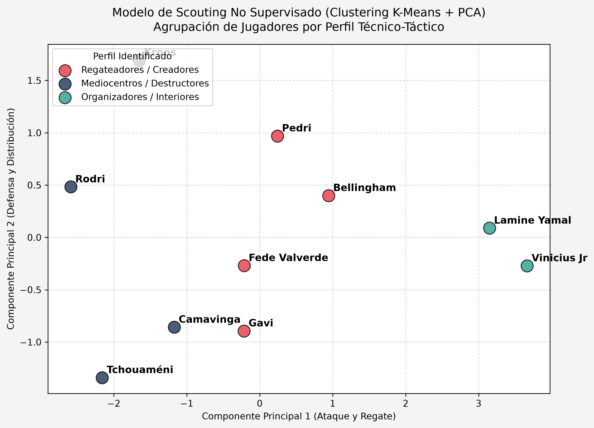

# ⚽ Sports Analytics & Football Data Science

Repositorio de proyectos de analítica de datos aplicada al fútbol, desarrollo de modelos estadísticos y algoritmos de Machine Learning. 

Desarrollado por **Jorge Fernández Villar** (Estudiante de Ingeniería y Sistemas de Datos en la UPM).

---

## 📌 Proyectos y Modelos Incluidos

### 1. Modelo de Scouting Inteligente (Machine Learning No Supervisado)
* **Archivo:** `scouting_clustering.py`
* **Descripción:** Aplicación del algoritmo **K-Means** y reducción de dimensionalidad con **PCA** (Análisis de Componentes Principales) para agrupar futbolistas automáticamente en función de sus métricas de rendimiento por 90 minutos.

---

### 2. Trinidad de Visualización Espacial y Eventos
* **Mapa de Pases (`pases_messi.py`):** Filtrado y representación de coordenadas de pases completados e incompletos.
* **Mapa de Tiros y xG (`mapa_tiros_xg.py`):** Visualización espacial de remates escalando el tamaño de cada disparo en función de los **Goles Esperados ($xG$)**.
* **Mapa de Calor KDE (`mapa_calor_jugador.py`):** Cálculo de densidad espacial (*Kernel Density Estimation*) para identificar las zonas de mayor ocupación de un futbolista.

---

### 3. Scouting Multidimensional y Extracción de Datos
* **Radar de Scouting (`radar_scouting.py`):** Gráfica radial parametrizada para la evaluación visual rápida de perfiles futbolísticos.
* **Procesamiento de LaLiga (`estadisticas_laliga.py`):** Conexión con datos abiertos de **StatsBomb**, agrupación de métricas acumuladas por jugador con **Pandas** y exportación automática a archivo CSV.

---

## 🛠️ Tecnologías y Librerías Utilizadas

* **Lenguaje:** Python 3.x
* **Ciencia de Datos & ML:** `scikit-learn`, `pandas`, `numpy`
* **Visualización:** `mplsoccer`, `matplotlib`
* **Proveedor de Datos:** StatsBomb Open Data