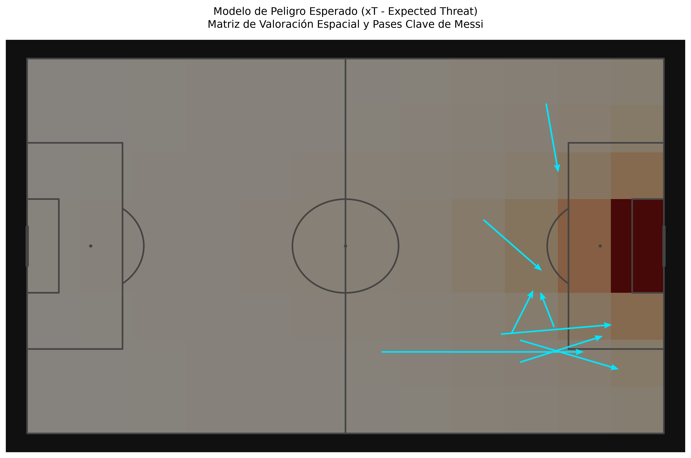
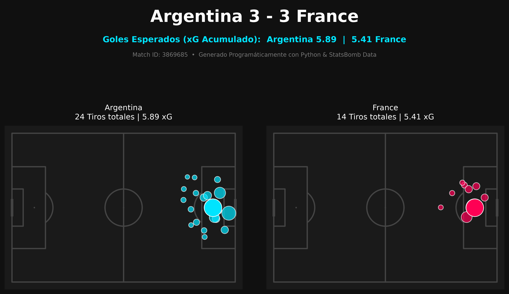

# ⚽ Sports Analytics & Football Data Science

Repositorio modular de proyectos de analítica de datos aplicada al fútbol, modelado estadístico avanzado ($xG$, $xT$), Machine Learning no supervisado para scouting y desarrollo de dashboards interactivos.

Desarrollado por **Jorge Fernández Villar** — *Estudiante de Ingeniería y Sistemas de Datos en la Universidad Politécnica de Madrid (UPM)*.

---

## 📌 Módulos Destacados & Modelos Avanzados

### 1. Web App Interactiva (Plataforma Profesional con Streamlit)
- **Archivo:** `app.py`
- **Descripción:** Cuadro de mando interactivo con interfaz oscura de estética ejecutiva y motor de ingesta dinámica en cascada (**Competición $\rightarrow$ Temporada $\rightarrow$ Jornada/Fase $\rightarrow$ Partido**) sobre la base de datos de StatsBomb.
- **Funcionalidades Clave:**
  - **📊 Resumen & Flujo de xG:** Gráfica de flujo acumulado (*xG Timeline*) minuto a minuto con anotación automática de goles.
  - **🛡️ Análisis Táctico de Equipos:** Comparativa de distribución de remates y mapas térmicos ocupacionales (*Kernel Density Estimation*).
  - **👤 Scouting Individual de Jugadores:** Ficha técnica personalizada con filtro por futbolista, efectividad de pases vectoriales (completados vs. incompletos), métricas de recuperaciones, xT aportado y mapa de calor individual.
  - **⚡ Peligro Esperado ($xT$):** Cuantificación de valor añadido por pase sobre matriz de $12 \times 8$ y ranking automático de generadores de peligro.

---

### 2. Modelo de Scouting Inteligente (Machine Learning No Supervisado)
- **Archivo:** `scouting_clustering.py`
- **Descripción:** Algoritmo de aglomeración **K-Means** y reducción de dimensionalidad con **PCA** (Análisis de Componentes Principales) para la clasificación automática de futbolistas por perfil técnico-táctico a partir de métricas normalizadas por 90 minutos.

---

### 3. Modelo de Peligro Esperado ($xT$ - Expected Threat)
- **Archivo:** `modelo_xt.py`
- **Descripción:** Matriz de probabilidad espacial sobre rejilla discreta de $12 \times 8$ para cuantificar el incremento de amenaza de gol tras pases y conducciones proyectados hacia zonas de mayor valor.

---

### 4. Generador Automático de Informes Post-Partido (Match Reports)
- **Archivo:** `informe_partido.py`
- **Descripción:** Pipeline de procesamiento de eventos en segundo plano y maquetación programática para generar infografías ejecutivas de alta resolución con métricas agregadas de $xG$ y mapa de tiros.

---

## 📐 Colección de Análisis Espacial y Eventos

- **`pases_messi.py`**: Filtrado y representación espacial con vectores de pases completados e incompletos.
- **`mapa_tiros_xg.py`**: Visualización de remates con escalado de disparos en función del valor de $xG$.
- **`mapa_calor_jugador.py`**: Estimación de densidad Kernel (KDE) para el análisis de ocupación de zonas.
- **`radar_scouting.py`**: Gráfico radial parametrizado para evaluación de perfiles multidimensionales.
- **`estadisticas_laliga.py`**: Extracción, limpieza y agregación de métricas de acumulación con Pandas exportadas a CSV.

---

## 🛠️ Tecnologías Utilizadas

- **Lenguaje:** Python 3.11+
- **Ciencia de Datos & ML:** `scikit-learn`, `pandas`, `numpy`
- **Visualización & Web:** `streamlit`, `mplsoccer`, `matplotlib`
- **Proveedor de Datos:** StatsBomb Open Data

---

## 📩 Contacto

**Jorge Fernández Villar**
**jorgepelayo2007@gmail.com**
*Ingeniería y Sistemas de Datos — Universidad Politécnica de Madrid (UPM)*  
- **GitHub:** [jorge-football-analytics](https://github.com/jorge-football-analytics)